# My AI Engineering Journey

> I'm learning AI engineering from scratch, one lesson at a time, by following the course at [aiengineeringfromscratch.com](https://aiengineeringfromscratch.com).
> This repo holds the code I typed, ran and broke on purpose along the way.

**The rule I follow:** read the lesson, run the code, break it on purpose, rebuild it from memory, and only then ask for help.

---

## Index

Click any link to jump straight to it.

| # | Lesson | Jump to my notes | Code in this repo |
|---|---|---|---|
| 1 | Dev Environment | [Lesson 1](#lesson-1-dev-environment) | [lesson-01-dev-environment](phase-0/lesson-01-dev-environment) |
| 2 | Git and Collaboration | [Lesson 2](#lesson-2-git-and-collaboration) | practiced on a fork, no code here |
| 3 | Python Environments | [Lesson 3](#lesson-3-python-environments) | [lesson-03-python-environments](phase-0/lesson-03-python-environments) |
| 4 | Docker for AI | [Lesson 4](#lesson-4-docker-for-ai) | used the course's own Dockerfile, no code here |
| 5 | Data Management | [Lesson 5](#lesson-5-data-management) | [lesson-05-data-management](phase-0/lesson-05-data-management) |
| 6 | Terminal and Shell | [Lesson 6](#lesson-6-terminal-and-shell) | [lesson-06-terminal-and-shell](phase-0/lesson-06-terminal-and-shell) |

**Other sections**

- [Where I am](#where-i-am)
- [Folder map](#folder-map)
- [Try it yourself](#try-it-yourself)
- [What is left out on purpose](#what-is-left-out-on-purpose)
- [Mistakes I made](#mistakes-i-made)
- [What is next](#what-is-next)

---

## Where I am

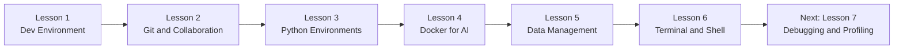

Lessons 1 to 6 are done. Each one has a short section below with what I learned, in plain words.

[Back to index](#index)

---

## Folder map

```text
ai-engineering-journey/
├── README.md
├── .gitignore
└── phase-0/
    ├── lesson-01-dev-environment/
    │   ├── gpu_check.py          # Can PyTorch see my GPU?
    │   ├── verify.py             # Python + NumPy sanity check
    │   ├── hello/                # Hello world in Python, TypeScript, Rust, Julia
    │   └── hello-rust/           # A tiny Rust project built with cargo
    ├── lesson-03-python-environments/
    │   └── my-ai-project/        # pyproject.toml + uv.lock
    ├── lesson-05-data-management/
    │   ├── step2_load.py         # Load the IMDB dataset
    │   ├── step3_stream.py       # Stream Wikipedia without downloading it
    │   ├── step4_formats.py      # Save data as CSV, JSON and Parquet
    │   ├── step5_splits.py       # Train / validation / test split
    │   ├── step5c_70_15_15.py    # My own 70/15/15 split
    │   ├── step6_models.py       # Download and cache a model
    │   ├── ex1_glue.py           # Explore the GLUE (MRPC) dataset
    │   ├── ex2_c4.py             # Count streamed rows in 10 seconds
    │   └── .gitignore            # Keep big data and model files out of git
    └── lesson-06-terminal-and-shell/
        └── make_fake_log.sh      # Makes a fake training log to practice on
```

[Back to index](#index)

---

## Lesson 1: Dev Environment

**In one sentence:** I built my AI workshop, one layer at a time, from the bottom up.

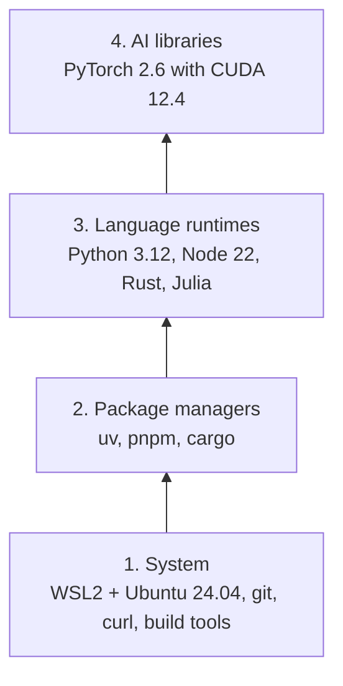

Each layer sits on the one below it. If something in a higher layer breaks, I check the layers underneath first.

| Tool | What it does for me |
|---|---|
| **WSL2 + Ubuntu** | A Linux workshop inside Windows, where most AI tools work best |
| **uv** | Fast Python installer and virtual environment maker |
| **Python 3.12** | The main language for AI work |
| **Node 22 + pnpm** | For the TypeScript lessons later |
| **Rust + cargo** | For performance-heavy lessons later |
| **PyTorch + CUDA** | Deep learning on my NVIDIA RTX 3050 laptop GPU (4 GB) |

**What I built:** `gpu_check.py` proves PyTorch can use my GPU, and `hello/` runs "hello world" in four languages to prove every toolchain works.

[Back to index](#index)

---

## Lesson 2: Git and Collaboration

**In one sentence:** git is a save button with a time machine, and GitHub keeps a backup online.

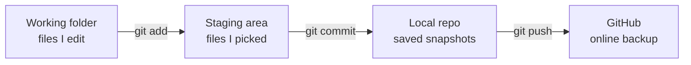

The order is always **add, then commit, then push**. I run `git status` before every `git add`.

- I **forked** the course repo (made my own copy on GitHub), made a branch called `my-progress`, committed a file and pushed it.
- A **branch** is a safe copy to experiment on. If the experiment works, I merge it back. If it fails, I delete it.
- I keep model checkpoints (`.pt`, `.pth`, `.safetensors`) out of git. They are huge, and I can re-create them.

[Back to index](#index)

---

## Lesson 3: Python Environments

**In one sentence:** one project, one virtual environment, so projects never break each other.

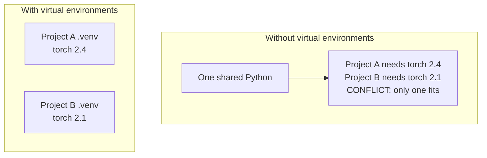

- `pyproject.toml` is the **recipe** (what the project needs).
- `uv.lock` is the **receipt** (the exact version of everything that was installed).
- I proved isolation myself: two environments held two different NumPy versions (1.26.4 and 2.5.3), and neither touched the other.
- The reliable check for "am I in the venv?" is `which python`. It should end in `.venv/bin/python`.

**What I built:** a `pyproject.toml` for a project that needs PyTorch and the Anthropic SDK, plus its lockfile.

[Back to index](#index)

---

## Lesson 4: Docker for AI

**In one sentence:** Docker packs a whole environment into one box that runs the same everywhere.

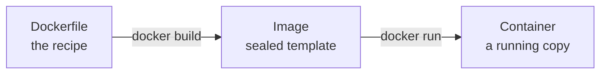

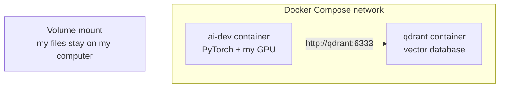

- **Image** = the recipe. **Container** = the kitchen cooking from it.
- I built the course's `ai-dev` image (about 21.5 GB on disk, and the first build took about 52 minutes). Later builds were nearly instant because Docker reuses unchanged **layers**.
- Inside the container, PyTorch saw my GPU: `PyTorch 2.6.0+cu124, CUDA: True`.
- A **volume mount** keeps files on my computer, so nothing is lost when a container is deleted. I proved it by writing a file from inside a container and finding it afterwards.
- With **Docker Compose**, the AI container reached the Qdrant database **by its service name** (`qdrant`), not an IP address.

I don't need Docker for every project. A virtual environment is usually enough when I'm learning on my own laptop.

[Back to index](#index)

---

## Lesson 5: Data Management

**In one sentence:** find data, pack it neatly, split it fairly, and keep the big files out of git.

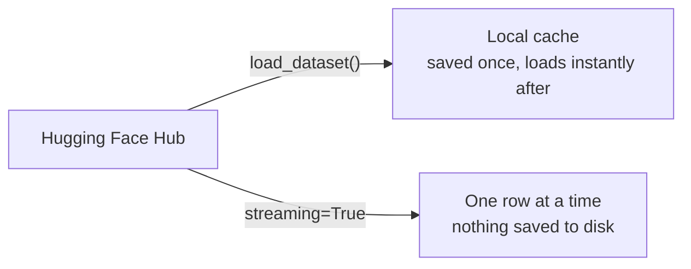

Downloading is like waiting for a whole movie to copy before pressing play. Streaming is watching it live. (I read 13,603 rows of a huge dataset in 10 seconds without saving anything.)

**File formats (I measured these on IMDB):**

| Format | Size | Best for |
|---|---|---|
| Parquet | **20 MB** | Storing data (small and fast) |
| CSV | 32 MB | Sharing, spreadsheets |
| JSON | 33 MB | Apps and APIs |

My prediction was backwards, which taught me more than a right guess would have.

**Train, validation and test splits.** Study from the textbook (train), take a practice test (validation), and sit the final exam (test) that the model has never seen. The second split cuts from the **leftovers**, not from the original:

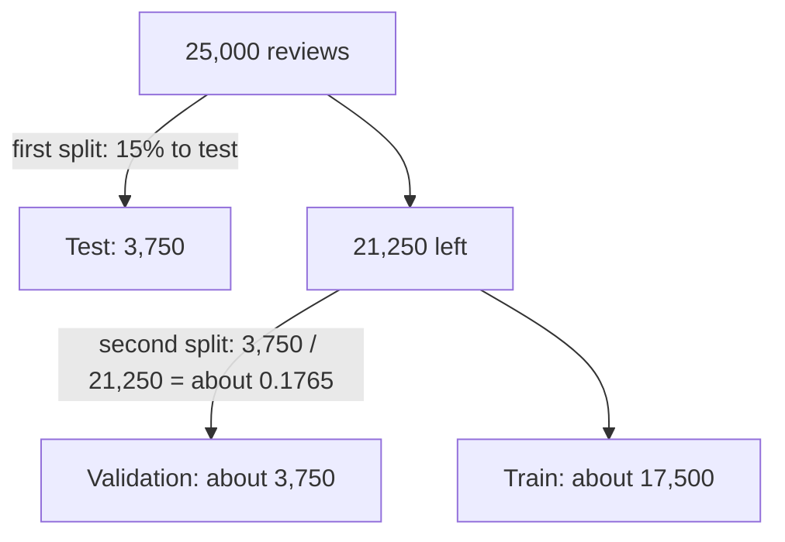

Using `seed=42`, the same settings always give the same rows.

[Back to index](#index)

---

## Lesson 6: Terminal and Shell

**In one sentence:** the terminal is my walkie-talkie to the computer, and these are the tricks that make it fast.

### The tricks, in kid words

| Trick | Kid version |
|---|---|
| Pipe `\|` | A conveyor belt: one command's output rolls straight into the next command |
| Redirect `>` | Pour the output into a notebook (a file) instead of onto the screen |
| `&` | Ask someone else to cook while I keep chatting |
| `nohup` | Earplugs: the program ignores the "hang up" signal |
| `tmux` | A TV with split screens that keeps playing after I leave the room |
| Alias | A nickname for a long command |

### Pipes: from a firehose to a clean list of numbers

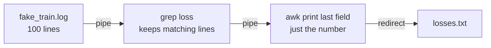

The last command in a pipeline decides what I see: `wc -l` ends with a count, while `awk` ends with words.

### Programs have two mouths

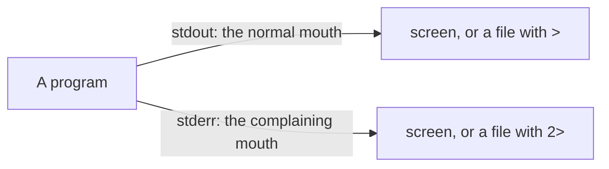

| Symbol | What it does |
|---|---|
| `>` | Writes normal output to a file (replaces it) |
| `>>` | Adds normal output to the end of a file |
| `2>` | Writes errors to a file |
| `2>&1` | Sends errors to the same place as normal output |

### What happens when I close the terminal (I proved this myself)

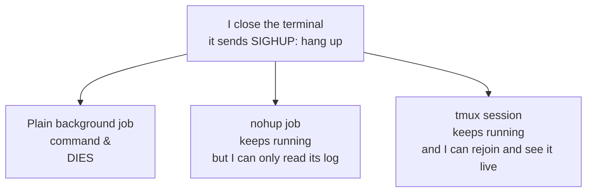

- I started a plain `sleep 300 &` and a `nohup sleep 301 &`, closed the terminal, and only the `nohup` one survived.
- In `tmux`, a counting job read **40** lines while I was outside the session and **498** after I closed the terminal and came back. It kept running the whole time, and finished by itself at 1,000.

### tmux in one picture

```text
tmux session: training            (Ctrl+B, then d = detach, and the session keeps running)
+--------------------------------------------+
| pane: htop                                 |   what is using my computer?
+--------------------------------------------+
| pane: watch -n1 date                       |   a live clock (stand-in for a GPU monitor)
+--------------------------------------------+
| pane: a Python script                      |   a stand-in for a training run
+--------------------------------------------+
```

Reattach later with `tmux attach -t training`.

### Commands I can now use

| I want to... | Command |
|---|---|
| Count lines in a file | `wc -l file` |
| Keep only lines with a word | `grep "word" file` |
| Print the last word of each line | `awk '{print $NF}'` |
| Start a job in the background | `command &` |
| List or stop background jobs | `jobs` and `kill %1` |
| Survive a closed terminal | `nohup command > log 2>&1 &` |
| Start, leave and rejoin a tmux session | `tmux new -s name`, Ctrl+B then d, `tmux attach -t name` |
| Find the biggest memory users | `ps -eo pid,%mem,rss,comm --sort=-rss \| head` |
| Tunnel a remote Jupyter to my laptop | `ssh -L 8888:localhost:8888 user@host` |

I also added the course's shell aliases (nicknames like `gpu`, which prints one line about my GPU) to my shell setup.

### What is in the code folder

[`make_fake_log.sh`](phase-0/lesson-06-terminal-and-shell/make_fake_log.sh) writes a fake training log of 100 lines, where the loss shrinks like a learning model. I used that log to practice every pipe and redirect above. The log it makes is ignored by git, because `.log` files are in my `.gitignore`.

[Back to index](#index)

---

## Try it yourself

You need Python 3.11 or newer and [uv](https://docs.astral.sh/uv/).

```bash
git clone https://github.com/MustafaShirawala/ai-engineering-journey.git
cd ai-engineering-journey

uv venv
source .venv/bin/activate
uv pip install datasets huggingface_hub

python phase-0/lesson-05-data-management/step2_load.py
```

The first run downloads the IMDB dataset (about 84 MB). Later runs load it from the cache.

The GPU check needs PyTorch. It also works on CPU (it will just say CUDA is not available):

```bash
uv pip install torch
python phase-0/lesson-01-dev-environment/gpu_check.py
```

The Lesson 6 script needs the `bc` calculator (`sudo apt install bc` on Ubuntu) and writes `fake_train.log` into whatever folder you run it from:

```bash
bash phase-0/lesson-06-terminal-and-shell/make_fake_log.sh
```

[Back to index](#index)

---

## What is left out on purpose

| Left out | Why |
|---|---|
| `.venv/` folders | Hundreds of MB, and they don't move between machines |
| Datasets and model files | Big, and I can download them again |
| Log files (`*.log`) | They are generated, so I can re-make them |
| Compiled programs and `target/` | I can rebuild them from the source |
| Secrets (`.env`) | They never go to git |

The rule I use: **ignore what I can re-fetch, and protect what I can't replace.**

[Back to index](#index)

---

## Mistakes I made

- **Running Linux commands in PowerShell.** I look at my prompt before every command now.
- **"command not found" after installing a tool.** Usually a PATH problem: reload the shell, then check with `which`.
- **Using the wrong virtual environment.** The prompt prefix, like `(my-env)`, tells me which one is on.
- **A wrong `test_size` in my split.** Comparing the printed sizes with my own maths caught it.
- **Guessing instead of checking.** I ask the dataset what its labels mean with `.features["label"]`.
- **Reading a number before its column name.** I took a process ID for a memory size. Now I read the header first.
- **Thinking a closed terminal keeps programs running.** It doesn't. `nohup` and `tmux` do.

[Back to index](#index)

---

## What is next

- Lesson 7: Debugging and Profiling
- Phase 1: the math behind AI, where I start writing real models

*This README grows as I do.*

[Back to index](#index)