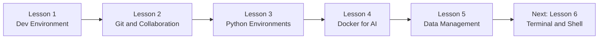
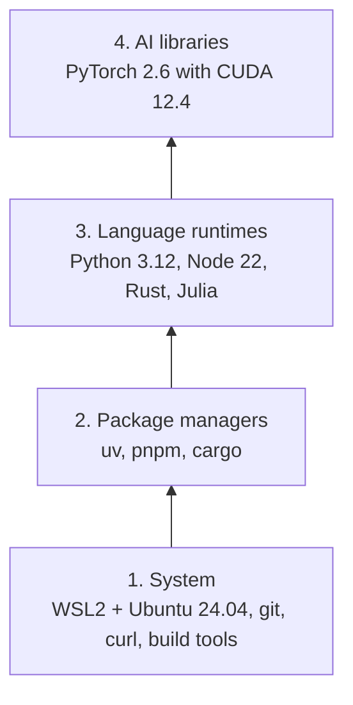
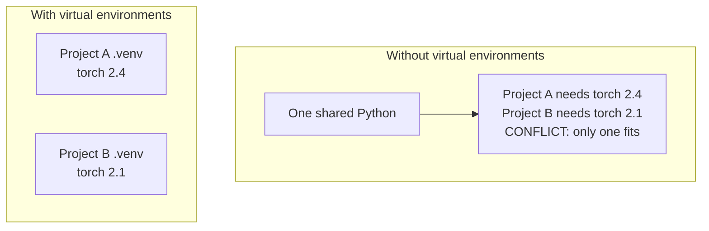
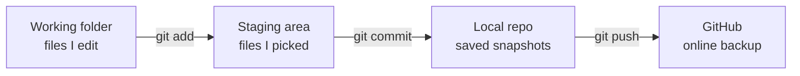
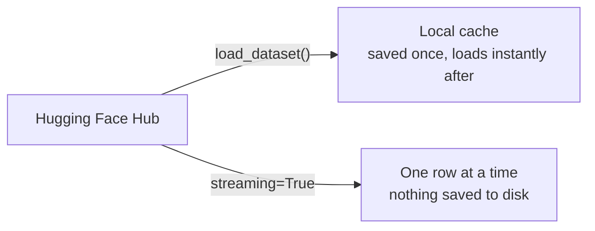
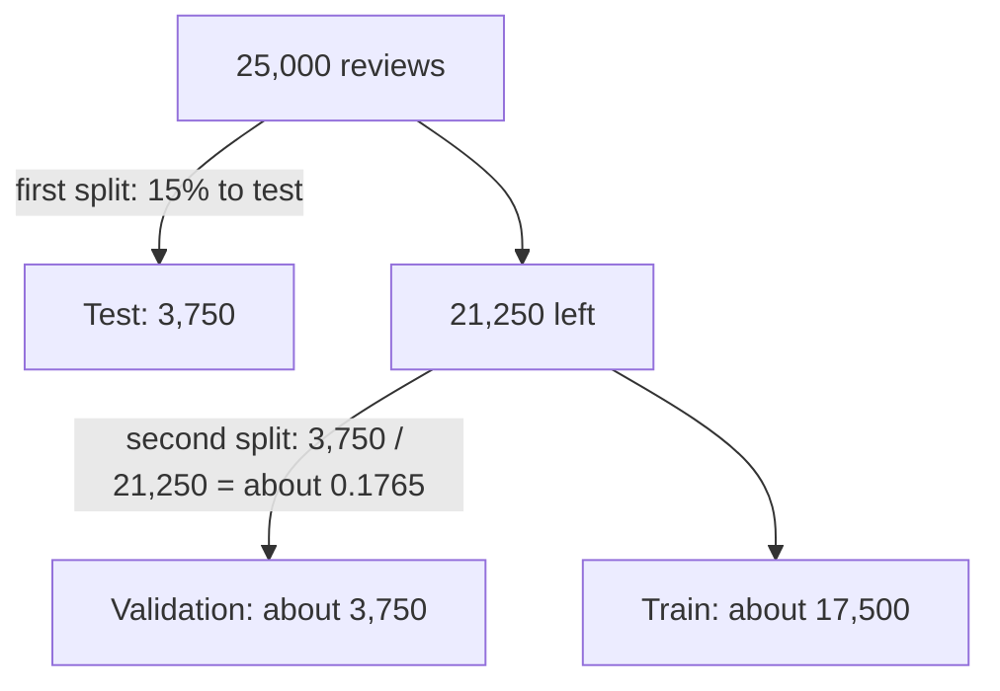

# My AI Engineering Journey

> I'm learning AI engineering from scratch, one lesson at a time, by following the course at [aiengineeringfromscratch.com](https://aiengineeringfromscratch.com).
> This repo holds the code I typed, ran and broke on purpose along the way.

**The rule I follow:** read the lesson, run the code, break it on purpose, rebuild it from memory, and only then ask for help.

---

## Where I am



| Lesson | Topic | In this repo |
|---|---|---|
| 1 | Dev environment | Setup checks, GPU check, "hello world" in 4 languages |
| 2 | Git and collaboration | Practiced on a fork of the course repo (no code to store here) |
| 3 | Python environments | A `pyproject.toml` and its lockfile |
| 4 | Docker for AI | Built and ran the course's image (no code of my own to store here) |
| 5 | Data management | 9 small scripts: load, stream, convert, split, cache |

---

## What's inside

```text
ai-engineering-journey/
├── README.md
├── .gitignore
└── phase-0/
    ├── lesson-01-dev-environment/
    │   ├── gpu_check.py          # Can PyTorch see my GPU?
    │   ├── verify.py             # Python + NumPy sanity check
    │   ├── hello/                # Hello world in Python, TypeScript, Rust, Julia
    │   └── hello-rust/           # A tiny Rust project built with cargo
    ├── lesson-03-python-environments/
    │   └── my-ai-project/        # pyproject.toml + uv.lock
    └── lesson-05-data-management/
        ├── step2_load.py         # Load the IMDB dataset
        ├── step3_stream.py       # Stream Wikipedia without downloading it
        ├── step4_formats.py      # Save data as CSV, JSON and Parquet
        ├── step5_splits.py       # Train / validation / test split
        ├── step5c_70_15_15.py    # My own 70/15/15 split
        ├── step6_models.py       # Download and cache a model
        ├── ex1_glue.py           # Explore the GLUE (MRPC) dataset
        └── ex2_c4.py             # Count streamed rows in 10 seconds
```

---

## My toolbox (built from the bottom up)

Each layer sits on top of the one below it. If something in a higher layer breaks, I check the layers underneath first.



| Tool | What it does for me |
|---|---|
| **WSL2 + Ubuntu** | A Linux workshop inside Windows, where most AI tools work best |
| **uv** | Fast Python installer and virtual environment maker |
| **Python 3.12** | The main language for AI work |
| **Node 22 + pnpm** | For the TypeScript lessons later |
| **Rust + cargo** | For performance-heavy lessons later |
| **PyTorch + CUDA** | Deep learning on my NVIDIA RTX 3050 laptop GPU (4 GB) |
| **Docker Desktop** | Packs a whole environment into one box that runs the same everywhere |

---

## Ideas I learned (explained simply)

### 1. One project, one virtual environment

Think of a toy box with a private shelf for each project. Installing something on one shelf never breaks another.



- `pyproject.toml` is the **recipe** (what the project needs).
- `uv.lock` is the **receipt** (the exact version of everything that was installed).

### 2. Saving my work with git



The order is always **add, then commit, then push**. I run `git status` before every `git add`.

### 3. Getting data: download it, or stream it



Downloading is like waiting for a whole movie to copy before pressing play. Streaming is watching it live.

### 4. Picking a file format (I measured this on IMDB)

| Format | Size | Best for |
|---|---|---|
| Parquet | **20 MB** | Storing data (small and fast) |
| CSV | 32 MB | Sharing, spreadsheets |
| JSON | 33 MB | Apps and APIs |

My prediction was backwards, which taught me more than a right guess would have. Parquet wins because it compresses and stores data column by column.

### 5. Train, validation and test splits

Study from the textbook (train), take a practice test (validation), and sit the final exam (test) that the model has never seen. The second split cuts from the **leftovers**, not from the original.



Using `seed=42`, the same settings always give the same rows.

---

## Try it yourself

You need Python 3.11 or newer and [uv](https://docs.astral.sh/uv/).

```bash
git clone https://github.com/MustafaShirawala/ai-engineering-journey.git
cd ai-engineering-journey

uv venv
source .venv/bin/activate
uv pip install datasets huggingface_hub

python phase-0/lesson-05-data-management/step2_load.py
```

The first run downloads the IMDB dataset (about 84 MB). Later runs load it from the cache.

The GPU check needs PyTorch and an NVIDIA GPU, and it also works on CPU (it will just say CUDA is not available):

```bash
uv pip install torch
python phase-0/lesson-01-dev-environment/gpu_check.py
```

---

## What this repo does not contain (on purpose)

| Left out | Why |
|---|---|
| `.venv/` folders | Hundreds of MB, and they don't move between machines |
| Datasets and model files | Big, and I can download them again |
| Compiled programs and `target/` | I can rebuild them from the source |
| Secrets (`.env`) | They never go to git |

The rule I use: **ignore what I can re-fetch, and protect what I can't replace.**

---

## Mistakes I made (and what they taught me)

- **Running Linux commands in PowerShell.** I look at my prompt before every command now.
- **"command not found" after installing a tool.** Usually a PATH problem: reload the shell, then check with `which`.
- **Using the wrong virtual environment.** The prompt prefix, like `(my-env)`, tells me which one is on.
- **A wrong `test_size` in my split.** Comparing the printed sizes with my own maths caught it.
- **Guessing instead of checking.** I ask the dataset what its labels mean with `.features["label"]`.

---

## What's next

- Lesson 6: Terminal and Shell
- Phase 1: the math behind AI, where I start writing real models

*This README grows as I do.*